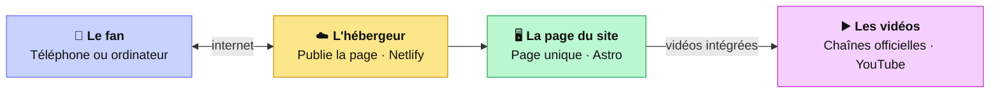

# Architecture de faker-tribute

> Comment ce projet est construit, expliqué pour quelqu'un qui ne lit pas le code.
> Tenu à jour par `/project-architecture` (an-forge) : la liste des dossiers est vérifiée par un script.

## 1. Vue d'ensemble

Un fan ouvre le site dans son navigateur. Le site est une seule page, préparée à l'avance à partir des textes du projet : aucun serveur ni base de données ne travaille quand on la visite. Les vidéos s'affichent depuis YouTube.



## 2. Les technologies

Les outils choisis pour construire le projet, et à quoi sert chacun.

| Partie | Technologie | À quoi ça sert |
|--------|-------------|----------------|
| Écrans | Astro | Fabrique la page du site à l'avance, sans serveur. |
| Langage | TypeScript | JavaScript avec des vérifications, pour repérer les erreurs avant publication. |
| Textes | Fichiers YAML + schémas | Le Parcours, le Palmarès et les Moments mythiques vivent hors du code, et sont vérifiés à la construction. |
| Tests | Vitest | Vérifie automatiquement que le site se comporte comme prévu. |
| Qualité | ESLint, `astro check` | Relisent le code et repèrent les fautes courantes. |
| Vidéos | YouTube (intégrées) | Affiche les vidéos de chaînes officielles sans les copier. |
| Hébergement | Netlify | Met la page en ligne. |
| Contrôles | GitHub Actions | Relance les contrôles sur chaque pull request. |

## 3. Les dossiers du projet

Où se trouve chaque chose. Un dossier, c'est un tiroir : chacun range un seul type de contenu.

<!-- an-forge:dossiers profondeur=2 -->
```text
faker-tribute/
├── .github/         # Réglages GitHub
│   └── workflows/   # Les contrôles lancés automatiquement sur chaque pull request
├── docs/            # La documentation du projet
│   ├── adr/         # Les grandes décisions techniques, une par fichier
│   ├── agents/      # La configuration des skills (tickets, vocabulaire)
│   └── briefs/      # Les résumés d'une page livrés avec chaque pull request
├── scripts/         # Les scripts de contrôle du projet (`checks.sh`)
├── src/             # Tout ce qui fabrique le site
│   ├── components/  # Les blocs de la page (En-tête, Parcours, Palmarès, Moments, Pied de page)
│   ├── content/     # Les textes du site, en fichiers de données
│   ├── data/        # Le chargement et la validation des textes, et les réglages du site
│   ├── layouts/     # Le cadre commun de la page (en-tête HTML, structure)
│   ├── pages/       # Les pages : une par adresse (ici, l'accueil)
│   ├── scripts/     # Les petits programmes du navigateur (animations)
│   └── styles/      # L'apparence : couleurs, tailles, mise en page
└── tests/           # Les tests automatiques
    └── helpers/     # Les outils partagés par les tests
```
<!-- /an-forge:dossiers -->
